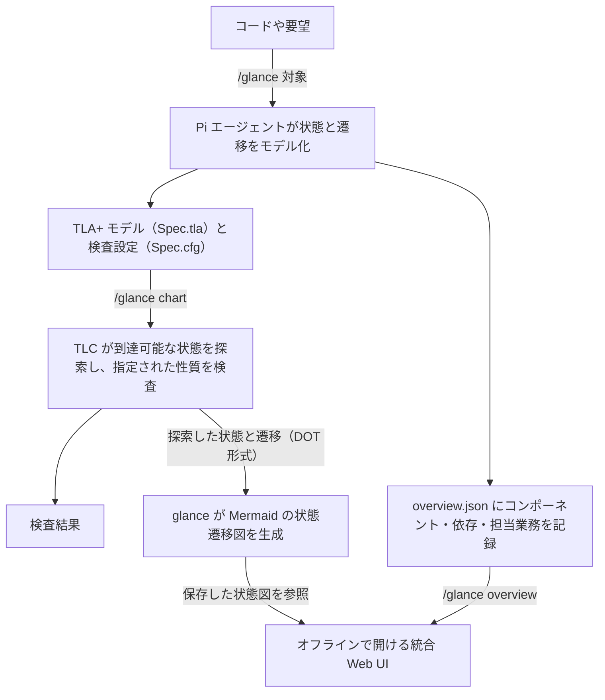

# glance

glance は、ソフトウェアの目的と操作、操作前後の状態や保証したい性質を、Pi エージェントと対話しながら考える extension です。状態から考える姿勢は [操作より状態・性質に着目する](https://zenn.dev/knowledgework/articles/c48539d2f35ecc) に影響を受けています。

## モデルを作って状態遷移図を見るまで



図を見て「この状態からも完了できてよい」と Pi に伝えたら、更新したモデルで `/glance chart` を再実行して遷移の変化を確認できます。

## 使い方

Pi で対象プロジェクトを開き、次のように実行します。

```text
/glance 個人用 TODO リストを設計したい
/glance この Go API の既存動作を分析し、完了機能の追加を考えたい
/glance この TypeScript プロジェクトの main からの変更を分析したい
```

エージェントが目的、実現したい状態、操作候補、操作前後の状態と性質を整理し、必要に応じて Mermaid の図と TLA+ モデルを提案します。Go、TypeScript、Java 向けの参照資料を用意しています。分析は Pi のエージェントによるコード読解であり、専用の静的解析器ではありません。対象、基準の Git ref、未確定事項を対話で伝え、結果を確認してください。

共通のモデル化手順は `skills/glance/SKILL.md` にあり、Go、TypeScript、Java、DB や外部サービスを扱う際は、それぞれの参照資料を対象に応じて読みます。`/glance` はスキルのパスをエージェントに明示するため、`-e` で extension だけを読み込んだ場合にも利用できます。パッケージとしてインストールすると、Pi のスキルとしても検出されます。

```text
/glance show    保存したモデルを表示
/glance deps    保存したコンポーネントの依存図（.glance/dependencies.md）を表示
/glance diff    保存した比較元と提案をエージェントに比較させる
/glance review  既存モデルとコードの対応をエージェントに精査させる
/glance check   TLC で保存した TLA+ モデルを検査
/glance chart   TLC で検査し、探索した状態を Mermaid の図にする
/glance chart --by phase    phase の値で状態をまとめて図にする
/glance overview init       エージェントが Web UI 用の入力を準備して生成する
/glance overview            保存済みの入力から Web UI を再生成する
```

作業ディレクトリの `.glance/model.md` に設計、既存コードや Git の基準を調べる場合は `.glance/baseline.md` に比較元を保存します。`.glance/Spec.tla` と `.glance/Spec.cfg` は検査用の TLA+ 仕様と設定です。ファイルはエージェントが作成・更新するため、実際の内容と根拠を確認してください。比較元の既存ファイルは勝手に置き換えません。Git 管理するかどうかはプロジェクトの方針に従ってください。

図に登場する名前の説明は `.glance/glossary.md` に保存します。`/glance chart` は図の直後にその内容を表示します。説明には、対象が何か、複数のものをひとまとめにした場合はその内訳、根拠、未確認事項を記します。説明はモデル作成者によるものであり、TLC が正しさを検証したものではありません。ファイルがなければ未記載と表示します。

## モデルの履歴

Pi でモデルを作成・更新すると、glance はプロジェクトの `.glance/history/v1/`、`v2/` … に、その時点の `Spec.tla` と `Spec.cfg` をセットで保存します。たとえば `SimulateFailure = TRUE` を `FALSE` に変えた場合、仕様が同じでも設定の変更として新しい版が残ります。

```text
/glance save      現在のモデルと設定を保存する（手で編集したときなど）
/glance history   版番号、保存日時（UTC）、前の版から変更されたファイルを一覧表示する
/glance diff v1   v1 と現在のモデル・設定を Pi に比較させる
```

保存対象は、Pi の処理開始時と終了時に揃っている二つのファイルです。待機中に `/glance <対象>` で既存モデルの検討を始めるときも、その時点の版を保存します。直前の版と内容が同じなら同じ番号を使います。各版の `metadata.json` には保存日時、ファイル別の SHA-256、取得できた場合は保存時の Git HEAD が入ります。これは作業場所のコミットで、作業ツリーの未コミット変更や分析対象に指定した別の ref は含みません。外部の TLA+ モジュールに依存するモデルの再検査には、そのモジュールも必要です。

## TLC による検査

Java 11 以降を用意し、glance ディレクトリで次のコマンドを一度実行します。公式 [TLA+ tools v1.7.4](https://github.com/tlaplus/tlaplus/releases/tag/v1.7.4) を取得し、固定した SHA-256 と照合してユーザーのキャッシュに保存します。自動ダウンロードは行いません。

```sh
npm run setup:tlc
```

既に JAR がある場合は `GLANCE_TLA2TOOLS_JAR=/path/to/tla2tools.jar` を指定することもできます。固定情報は `extensions/tlc-lock.json` に保存します。SHA-256 の照合はセットアップ時に行い、検査を実行するたびには行いません。指定した JAR のバージョンは自動確認せず、使用パスを結果に表示します。

`/glance check` は `.glance/Spec.tla` と `.glance/Spec.cfg` を使って TLC を最大 60 秒実行し、結果を表示します。`/glance chart` は同じ検査を実行し、TLC の DOT 出力を Mermaid に変換します。TLC が違反やエラーで途中停止した場合は、出力があっても不完全な図として示します。図はモデル上の状態をそのまま表示するため、状態数が多いと読みにくくなります。設定の制約や対称性による探索範囲にも注意してください。

両コマンドは `Spec.cfg` の内容を結果とともに表示します。定数や制約を確認し、他の条件が検査されたと推測しないためです。表示時と TLC 読み込み時の間にファイルが変わった場合は内容が異なることがあります。TLC が解釈可能な反例を報告した場合は、探索全体の図とは別に、その状態の経路を図示します。TLC の出力形式や切り詰めによって経路を読み取れない場合、図を推測して生成せず、TLC の出力を表示します。

成功はその設定で検査したモデルに限られ、実装がモデルに従うことの保証や形式証明ではありません。TLA+ の生成やモデル化の精度はエージェントの応答に依存し、TLAPS による形式証明の自動実行は未実装です。

`--by` には表示したい TLA+ 変数をカンマ区切りで指定できます（例: `--by phase,agent`）。指定変数の値が同じ状態をまとめ、各グループの元の状態と遷移を一覧に表示します。集約後の矢印は少なくとも一つの元状態で可能な遷移を意味し、全ての元状態で可能とは限りません。また、図上で連続する矢印が元モデルで連続できるとは限りません。各状態の性質違反はこの図には表示されません。`--by` を省くと元の図に戻ります。PoC では単一行の単純な値のみ対応し、それ以外はエラーとして扱います。

小さな例を試すには、空の作業ディレクトリを作り、`examples/todo/Spec.tla`、`Spec.cfg` と `glossary.md` をその `.glance/` にコピーしてから `/glance chart` を実行してください。この例では `todo → inprogress → done` と型に関する不変条件を扱います。

## 依存関係と状態遷移を一つの画面で見る

Pi で `/glance overview init` を実行すると、エージェントがコンポーネント、業務、それぞれに対応する状態図を `.glance/overview.json` にまとめます。生成した `.glance/overview.html` をブラウザーで開いてください。

全体図はホイールやピンチで拡大縮小し、ドラッグで移動できます。コンポーネントをタップすると、その位置で接続の説明と担当する状態図が開きます。別のコンポーネントも続けて展開でき、もう一度タップするとその分を閉じます。青いノートを選ぶと状態遷移を読めます。「依存と状態を1枚で見る」は全業務を並べて確認するための統合図です。

状態図は保存済みの Mermaid を参照します。図や対応関係を更新したら `/glance overview` で再生成できます。生成には Graphviz の `dot` が必要です。HTML には図、説明、指定したソース行の抜粋を埋め込むため、閲覧はオフラインでできます。画面の検査結果には入力に記録された内容を表示します。現在の TLA+ モデルを検査するコマンドは `/glance check` です。

このリポジトリで TODO の例を試すには、次を実行して出力された HTML を開きます。

```sh
demo_dir=$(mktemp -d)
mkdir "$demo_dir/.glance"
cp examples/todo/* "$demo_dir/.glance/"
npm run overview -- "$demo_dir"
```

入力の最小構成と各項目は [Web UI の入力形式](skills/glance/references/overview.md) を、二つのコンポーネントと一つの状態図を持つ例は [TODO の入力](examples/todo/overview.json) を参照してください。

## インストールと開発

ローカルから使う場合は、このリポジトリで `npm ci` を実行してからインストールします。

```sh
pi install /path/to/glance
```

一時的に読み込む場合は `pi -e /path/to/glance/extensions/index.ts` を実行します。

開発には Node.js 26.13.0 と Pi を用意し、`npm ci` の後に `npm run typecheck`、`npm test`、`npm run check:package` を実行します。
実際の TLC を使った結合テストは `GLANCE_TLA2TOOLS_JAR` を設定すると有効になります。
全体図のブラウザーテストは Graphviz の `dot` と Chromium を使います。Chromium の実行ファイルは `GLANCE_CHROMIUM` で指定できます。未指定の場合は PATH 上の `chromium` または `google-chrome` を使います。

モデル化の品質を確かめる合成ケースは [ベンチマーク](benchmarks/README.md) を参照してください。

MIT License。詳細は [LICENSE](LICENSE) を参照してください。
